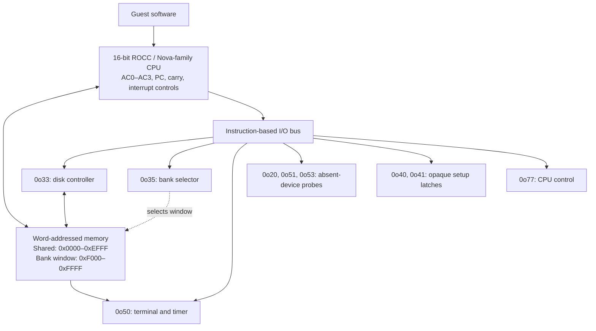

# ROCC machine architecture

Companion: [CPU instruction set](cpu-isa.md).

## 1. Scope and confidence

The working hardware family is **ROCC 2800 Classic**. Exact model and processor
revision are unresolved. This document describes the current Rust emulator's
inferred contract, not an official vendor hardware specification.

| Label | Meaning |
| --- | --- |
| BASE | Nova-family behavior used by the emulator. |
| RECOVERED | Behavior inferred from software execution dependencies. |
| MODEL | Explicit emulator choice or resource limit. |
| OPEN | Hardware behavior remains unresolved. |

Addresses refer to 16-bit words unless identified as byte offsets. Hexadecimal
uses `0x`; device numbers use octal `0o`. Bare numbers are decimal.

## 2. System overview



This is a logical diagram, not a physical bus schematic. I/O uses CPU instructions
rather than a modeled memory-mapped region. DMA completes synchronously in the
emulator; guest software observes status and interrupt completion. Physical bus
width, backplane, arbitration, clock rate, and processor technology remain open.

## 3. Addressing, RAM and bank control

Recovered working profile:

```text
  Word size             16 bits, represented big endian
  Logical address       16-bit word address: 65,536 words = 128 KiB
  Shared/global region  0x0000..0xEFFF:61,440 words = 120 KiB
  Local window          0xF000..0xFFFF:4,096 words = 8 KiB
  Allocated local banks 128 [MODEL capacity, not measured installed RAM]
  Total allocated RAM   61,440 +128 * 4,096 =585,728 words =1,171,456 bytes =1,144 KiB
```

The 128-bank allocation is an emulator capacity, not a measurement of installed
hardware RAM. The non-extended profile uses flat memory.

Current emulator physical indexing, for logical word a and selected bank b:

```text
  a <0xF000: physical_index = a
  a >=0xF000: physical_index = a + b * 4096
```

This is an emulator storage layout, not a physical address-bus schematic.
Fetches and ordinary data accesses share this mapping. Lower memory is visible
unchanged in every bank. There is no recovered protection or virtual-memory MMU.

Device 0o35 [RECOVERED]:

```text
  DOA/DOAS selector  high byte selects bank 0..127; retain full selector
  DIA               read back full selector
  NIOC              accepted after bank clear; no proven extra effect
  SKP               idle:busy=false,done=false
  selector 0xFFFF    global-only task; accesses to 0xF000..0xFFFF stop [MODEL]
```

Unknown bank numbers/operations stop. The low selector byte's mapping/cache/access
meaning is OPEN. 0x0080 and 0x0000 currently select the same bank, but are read back
as distinct selectors. 0xFFFF was observed when scheduling a shared-memory task;
leaving the local window unavailable avoids inventing an extra bank mapping.

Special bank-aware CPU operation 0x8208 reads local source data using M[2]>>8,
while local destinations use the active bank. All other recovered byte operations
use the active bank. RAM 2 is therefore a software-visible copy-source-bank
convention with direct instruction consequences; see the [block-copy contract](cpu-isa.md#6-rocc-extension-0x8208--forward-bank-aware-block-copy-recovered).

## 4. Interrupt and scheduler architecture

CPU device 0o77 supplies enable/disable, pending-device number, mask and reset.
Recognition saves PC at RAM 0 and jumps through RAM 1. Accumulators/carry are saved by
software. The ION delay permits one following instruction before recognition.
A set mask bit disables the corresponding modeled interrupt source:

```text
  disk 0o33:0x2000; terminal 0o50:0x8000.
```

The emulator checks disk before terminal. Complete hardware priorities and other
mask bits are OPEN; device numbers must not inherit a stock DG interrupt map.
DIB 0o77 identifies a pending source but does not consume its peripheral event.

Scheduling and context preservation are guest software operations. The CPU has
no modeled scheduler primitive.

## 5. Disk controller 0o33

The controller model transfers 256-byte blocks using the mapping below. This
is a compatibility model, not a physical drive identification.

Normal DMA registers:

```text
  A bit 12 (0x1000)   0=read disk into memory;1=write memory to disk
  A bit 5            low head-selection bit
  A bits 4..0        sector 0..31
  A other bits      unsupported (except separate 0x2000 control)
  B                 first CPU memory WORD address;128 words transferred
  C bits 9..0        cylinder
  C bits 15..10      paired-head index
```

Mapping:

```text
  cylinder = C &0x03FF
  head = (C>>10)*2 + ((A>>5)&1)
  sector = A &31
  image_byte_offset = (cylinder*20 +head)*8192 +sector*256
```

A head>=20, transfer beyond image or CPU address range, unsupported command bits,
or a write from unknown memory stops. Disk DMA uses the currently mapped RAM
bank if it accesses the local window; global-only tasks cannot DMA into it.

Implemented I/O contract:

```text
  DOA A       latch A
  DOAC A      latch A and clear busy/done
  DOB B       latch destination/source word address
  DOCS C      latch C and execute transfer; done=true,busy=false on success
  DIA         status 0 for successful modeled operation
  DIAC        status 0 and clear busy/done
  DIB         end DMA word address (B+128)&0xFFFF, once initialized
  NIOC        reset controller latches/status and DMA-end result
  SKP         standard modeled busy/done conditions from ISA reference
```

The A/B/C names denote device registers, not CPU AC registers. Original code can
use different accumulators to supply them. Successful DMA-end result survives a
DIAC status acknowledgement but not reset. Disk counts and overlay contents
survive controller reset in the emulator.

Separate startup control:

```text
  A=0x2000, C=0x2000, issued with DOCS, completes without DMA.
  A following NIOP is admitted once for this control phase.
  No physical name such as seek/recalibrate is assigned.
```

Preservation/model boundary:
Disk contents are loaded read-only. Guest writes replace 256-byte blocks in a
separate overlay; reads prefer overlay blocks. CLI runs persist these blocks
between launches as described below. The JSON report also includes changed
blocks. The original image is never rewritten. Successful transfers return
status 0 after the overlay write is flushed [MODEL].
Actual busy timing, error flags, retry behavior, multiple units, physical DMA
arbitration and reset effects beyond the implemented device are OPEN.

### Persistent disk overlays

By default, the CLI appends `.overlay` to the image path: `disk.img` uses
`disk.img.overlay`. `--overlay PATH` overrides that name. Existing overlays are
loaded before the bootstrap block is copied into RAM, so saved changes to the
boot sector also take effect. The base image's SHA-256 in reports and
`--expected-sha256` always refer to the original image, excluding overlay data.
Reports include the resolved `overlay_path`.

The overlay must be a separate regular file. Final-component symlinks and
hard-link aliases of the original image are rejected. Newly created overlays
have mode `0600` (subject to the process umask), and an exclusive advisory lock
prevents cooperating emulator processes from sharing an overlay concurrently.
The overlay must be writable, including for sessions that do not issue disk
writes. Library users constructing `Machine::new` retain an in-memory disk until
they call `attach_overlay` before executing instructions.

Version 1 is an append-only binary journal, with all integers big endian:

| Part | Layout |
| --- | --- |
| Header (48 bytes) | ASCII `ROCCOVL1` (8), original image byte length (8), original image SHA-256 (32 raw bytes). |
| Write record (296 bytes) | Image byte offset (8), block data (256), SHA-256 of the preceding offset and data (32 raw bytes). |

Offsets must be 256-byte aligned and identify a complete block within the base
image. On replay, the latest record for each block wins. Each successful write
is synced before the in-memory overlay, write count, and completion are updated.
An I/O or sync failure stops execution with `disk_overlay_write`. A complete
record may survive a sync failure even though the guest did not receive
completion; recovery may therefore include that last write.

On reopening, incomplete final records are discarded after all complete records
have been validated. Invalid headers, base-image mismatches, invalid offsets,
and complete records with bad checksums are rejected without rewriting the
overlay. An incomplete header is rejected rather than reset. The journal grows
by one record per write, including repeated writes to the same block; compaction is available through `compact-overlay IMAGE --overlay SOURCE
--output NEWPATH`; there is no merge-to-base operation. Preserve both the original image and
its overlay when backing up a session. To start again from the original state,
choose a fresh overlay path. Overlay files and JSON reports can contain guest
data and are private runtime artifacts.

## 6. Terminal/controller 0o50 and absent group 0o53

These are custom protocols recovered from the original driver, not a generic
Nova teletype. There are 8 probed channels on 0o50 and 4 on 0o53. The working emulator
presents only 0o50 channel 0. Controller presence and a connected terminal line are
separate conditions.

The following present-device behavior requires `--terminal experimental` with
the extended profile. Batch `--profile extended` alone defaults to terminal
`none`, which presents no terminal channels. Interactive mode selects the
experimental terminal by default.

Startup setup/probe:

```text
  DOAP values 0,128,...,896 on 0o50;0,128,256,384 on 0o53.
  Exact ordered outputs are recorded; physical setup effects are OPEN.
  DOA(0x0400 +channel*0x80), NIOS, status probe, DIAC tests presence.
  Present channel 0 yields event A=0; absent channels remain not-done.
```

Command bit 0x0400 is the original driver's busy query. Querying is not executing
or acknowledging the underlying command. The modeled device always reports not
busy; done indicates whether an event is queued. Runtime unknown commands stop.

Event interface:

```text
  DIA = event register A (status/channel information)
  DIB = event register B (data/status-specific value)
  DIC = event register C (additional value)
  Any of these with clear pulse pops the event; normal reads retain it.
  NIOC also pops one event. Reading an empty event queue stops.
```

The original handler reads DIA, DIB, then DICC so all three belong to one event.
Pending events generate IRQ 0o50 unless masked. Queue ordering is a MODEL choice.

Recovered/implemented channel 0 events, expressed as(A,B,C):

```text
  (0x0000,0,0)     terminal OUTPUT completion (also presence-probe response)
  (0x1000,key,0)   character ready; a CR is byte 13
  (0x2000,0,0)     line ready/online event
  (0x4000|tag,0,0) command-specific completion, NOT ordinary display completion
  (0x6000,0,0)     timer tick
```

An 0x8000 category exists in the original output-FIFO drain handler; automatic
emission/physical FIFO behavior is not implemented. Other status combinations,
line events and input modes are not fully decoded.

Display DMA [RECOVERED, narrowly implemented]:

```text
  DOA 0x0000; DOB buffer_word; DOC(0xE000 | byte_count).
  Require (C&0xF800)==0xE000 and count=C&0x07FF nonzero.
  Read ceil(count/2) big-endian words, send the first count bytes, complete with
  event(0,0,0). Odd transfers omit the last padding byte.
  Current support is channel 0 and SHARED RAM only; other modes/local DMA stop.
  Validate the whole source before capture/acknowledgement; capture limit 1 MiB
  is an emulator resource policy, not a terminal hardware limit.

```

In interactive mode the controller retains a bounded capture tail instead of
stopping at the batch capture limit; screen state continues updating. Both modes
bound bytes and packet count independently: defaults are 1 MiB and 4096 packets.
`--capture-bytes` accepts 1..67108864 and `--packet-limit` accepts 1..65536.
Total/retained packet and retained-byte counts are exported explicitly.
Byte history uses a ring buffer; packets are compact typed records serialized only
on export. Separate truncation flags identify which history was evicted.

All events share a checked queue (default 4096; `--event-limit` accepts 1..65536).
A command reserves completion capacity before memory reads or effects. A full
queue stops with `terminal_event_limit`; a full batch byte/packet history stops
with `terminal_capture_limit`. Connection/timer events due on the same tick reserve
capacity together. Timer coalescing tracks the pending event directly; popping it
through any clear operation permits the next tick event.

Immediate character output, recovered during interactive work:

```text
  DOA 0; DOB any_value; DOC byte_value, where byte_value is 0..255.
  Transmit the C byte directly, with zero-status completion.
```

The emulator requires a B-register latch after DOA, even for immediate output.
Its value may be a stale address: memory is not read in this mode. DOA and a
successful output each clear the pending B latch; issue DOB again before the
next output. This is the current controller contract, not a claim about every
physical terminal mode.

Display protocol subset/rendering [RECOVERED/MODEL]:

| Bytes (hex) | Modeled effect |
| --- | --- |
| `20`–`7E` | Printable ASCII; write at the cursor and advance the column. |
| `A0 row column` | Set cursor; low seven bits of each coordinate are used. |
| `A3 row column` | Set inclusive field endpoint. |
| `B6 fill` | Fill an in-bounds same-row field with printable ASCII (`20`–`7E`), without moving the cursor. |
| `A8 00` | Clear screen and attributes; move cursor to origin. |
| `A8 01 90 A8 00` | Clear rows 3–23 and their attributes; preserve rows 0–2 and cursor. |
| `A2 attribute` | Set the attribute byte; host rendering uses bit `08` for reverse video. |
| `B7` | Save cursor and attribute. |
| `B8` | Restore and consume an outstanding save; otherwise no effect. |
| `B4 B2 B8 A2 00 95` | Complete input field, retire endpoint, restore saved cursor if present, reset attribute. |
| `90`, `80`, `AE`, `AA`, `AB`, `B9` + one byte | Consume and record a parameter; other effects remain unresolved. |
| `08`, `09`, `0A`, `0D` | Backspace, tab, line feed, carriage return in the screen model. |
| `07` | Record bell control. |

The screen model is 24 rows by 80 columns. This does not establish every physical
terminal's dimensions or character set. Exact multi-byte sequences take precedence
over shorter commands and may span packet boundaries. Standalone `B4`, `B2`, and
`95` do not inherit the semantics of the complete field-completion sequence.
Unknown bytes are counted and retained in a bounded diagnostic history.
Printable text does not automatically wrap or scroll in the model.

Other accepted controller commands [mostly provisional]:

```text
  DOA 0xE000          stop timer; event 0x4000
  DOA 0xE001;DOC n    configure/start timer (n>0); event 0x4001
  DOA 0xF001          enable timer with retained period; event 0x4001
  DOA 0xE804          event 0x4004
  DOA Cxxx with (A&0xFC0F)==0xC001
                     immediate event 0x4000|(A&0x03FF)
  DOA Cxxx with (A&0xFC0F)==0xC000;DOC parameter
                     event 0x4000|(A&0x03FF)
  DOA A<0x0400;DOC 0x0800 without a pending DMA buffer
                     record channel mapping/setup value; no completion event
```

Low subchannel/tag bits must be retained in acknowledgements. Names/functionality
beyond these concrete effects are OPEN. `terminal.rs` is authoritative for accepted
query masks and combinations; acceptance does not establish complete commands.

Timer period is n * 1000 executed instructions [MODEL], not milliseconds or measured
hardware time. Repeated unconsumed ticks are coalesced. Actual clock calibration
and time-of-day hardware are OPEN.
Host connect_after schedules one line-online event after the specified instruction
count; it does not modify guest memory. send_key(byte) queues an input event.
The batch boot CLI prints captured output after a bounded run. The later
--interactive mode streams this screen and keyboard events through a native
terminal session; see the [README](../README.md).

## 7. Other device numbers

| Device | Accepted model |
| --- | --- |
| `0o20` | Absent optional device: DOAS accepted, DIAC returns zero, busy/done false. |
| `0o40` | Ordered DOAC `0x3237`, DOBC any value, DOCS `0xFFFF`; opaque latches, no DMA/IRQ. |
| `0o41` | DOAC `1` only; opaque setup latch. |
| `0o51` | DOAS `0xD80E`–`0xDB8E` in `0x80` increments; absent-device busy/done behavior. |
| `0o53` | Absent four-channel terminal group; exact setup/presence operations only. |
| `0o77` | CPU controls; see the [ISA reference](cpu-isa.md). |

Physical identities and positive-presence behavior of optional devices remain
open. Other device accesses stop. No tape, printer, network, real-time clock,
or secondary disk-controller protocol is implemented.

## 8. Bootstrap model

The CLI requires an explicit image path. The input must contain at least 24
complete 256-byte blocks and must not exceed 512 MiB. These are emulator limits.

`Machine::new` loads the first 256 bytes as 128 big-endian words at logical
addresses 0–127, initializes accumulators and carry to zero, and starts at word
127. It also initializes word 10941 to zero as a compatibility assumption.
Other memory starts unknown. This initialization is not a recovered ROM or a
claim about physical power-on state; see [machine.rs](../src/machine.rs).
The CLI then attaches its persistent overlay and reloads this bootstrap block
from the saved version if present.

Subsequent loader, interrupt-handler, runtime, and scheduler execution is guest
code. The emulator implements CPU/controller operations rather than substituting
host operating-system calls. No filesystem catalogue or application bytecode
interpreter is part of the hardware execution layer.

## 9. Profiles and unresolved behavior

| Profile | Behavior |
| --- | --- |
| `loader` | Flat memory; 15-bit default, optional 16-bit addressing; early block-copy behavior preserves input registers; restricted devices. |
| `extended` | 16-bit logical addressing, banked RAM, updated copy/byte operations, interrupts and inferred controller models. |

The extended profile is the subject of the architecture described above. See
[CPU ISA](cpu-isa.md) for exact extension decoding and the differences between
15-bit and 16-bit indirect addressing.

Unresolved hardware properties include CPU revision, assembler mnemonics,
additional extensions, physical RAM capacity, low bank-selector bits, true ROM
and reset state, bus timing/arbitration, block-copy interruptibility, exception
behavior, full interrupt priorities, peripheral error/status meanings, additional
terminal channels, FIFO behavior, physical keyboard codes, and tape/printer/network
controllers. Compatibility with a particular operating-system release requires
separate validation; the hardware family assumption alone does not establish it.

Strict stops, unknown-memory tracking, atomic rejected transfers, capture limits,
and the private overlay are emulator policies, not physical exception mechanisms.

## 10. Implementation and validation

- [CPU](../src/cpu.rs) and [memory](../src/memory.rs)
- [Device bus and controllers](../src/devices.rs)
- [Terminal controller](../src/terminal.rs) and [screen model](../src/screen.rs)
- [Interactive host terminal](../src/interactive.rs)
- [Machine initialization and execution clock](../src/machine.rs)
- [Streaming reports](../src/report.rs) and [private publication](../src/artifact.rs)
- [Build, run, and test instructions](../README.md)

The public tests use synthetic CPU cases and temporary synthetic disk images.
They exercise memory banking, DMA boundaries and failure atomicity, interrupt
ordering, terminal events, input parsing, display controls, and host-terminal
restoration. Passing them verifies implementation consistency, not complete
physical-machine fidelity.


## 11. Rust API boundaries

`MachineConfig::new` validates profile, address width, connection time and
`ResourceLimits` before machine allocation. Configuration fields and memory
geometry/storage/mapping are private. `Machine::with_config` consumes validated
settings; `Machine::new` remains a validated compatibility constructor.
`Cpu::new(address_bits, extended)` now returns a Result.

Memory's public `read`, `write`, `peek`, `physical`, `validate_range`, and
`initialize_physical` methods return typed faults for invalid addresses, banks,
unknown data, or global-only access. `iter_physical` exposes a read-only iterator.
Replace field mutation with `set_mapping(Mapping::SelectedBank(bank))` or
`Mapping::GlobalOnly`; geometry has immutable getters. Logical ranges use checked
addition and accept an empty range at the address-space endpoint.

Controllers accept `&mut Memory` rather than `&mut Cpu`. `Cpu::execute` implements
instructions only. `Machine::execute_step` owns terminal ticking, deferred IRQ
enable, interrupt entry, and instruction execution; both normal execution and CPU
fixtures use it. `Cpu::step` remains a forwarding compatibility method. A faulting
step still advances the instruction clock once; resource faults before fetch do
not execute an instruction. Disk completion and terminal readiness are typed
states; faults have a closed `FaultKind` and typed `FaultContext` variants with
stable external reason strings. `Fault::with` accepts a typed context rather than
arbitrary JSON; optional command values preserve explicit null diagnostics.
Library callers entering `interactive::run` must select Tail capture in validated
configuration. Incompatible capture policies are rejected before changing the
host terminal; the runtime cannot silently change the reported capture policy.

`Machine::summary` borrows the final screen and lightweight counters, with no
memory hashing or disk encoding. `write_report` streams borrowed report sections;
`Machine::report` is an explicit in-memory convenience API. Disk base/changed
blocks are encapsulated; controller writes are the path for changing disk state.

## 12. Report schema and host lifecycle

Schema 2 preserves legacy fields and adds effective configuration, package/build
identity, absolute instruction budget and scheduled keys. Interactive metadata
includes delivered `{step, byte}` keys, capped at 65536, and `replay_complete`.
The build revision is a Git revision with `-dirty` when detected, or `unavailable`
when built outside Git. The original base-image SHA-256 excludes overlay data.

Initial/final overlay state digests hash `ROCC-OVERLAY-STATE-1` followed by ascending
records encoded as an unsigned 64-bit big-endian offset and 256 raw block bytes.
Initial state is captured after attachment, before guest execution. Display
`sha256` and `retained_sha256` hash retained raw bytes; `full_stream_sha256` hashes
all successful output incrementally. Truncation flags distinguish byte/packet
retention. These records support comparison and input replay; they are not full
machine checkpoints and do not establish physical-machine correctness.

Private report/compacted-overlay files are created with mode 0600, synced before
no-overwrite publication, and followed by parent-directory synchronization.
Finalization failures after publication explicitly report that a complete file
was already published. Existing destinations and base images remain intact.

Interactive SIGINT, SIGTERM, and SIGHUP handlers only set a shutdown flag. The
normal loop restores termios, previous handlers, and host display state, then
exports a requested report and returns 128 + signal number. Keyboard Ctrl-C and
Ctrl-] retain user_exit. SIGKILL cannot be handled. Output waits are bounded so
an unresponsive host terminal cannot indefinitely prevent cleanup.
